# FIRE Market Sim — Симулятор начинающего инвестора

Десктоп-приложение (Next.js + React + Electron + SQLite) для обучения новичков
азам инвестиций на исторических данных (2013–2026).

> Подробная документация — в [`docs/project/`](docs/project/).

---

## Документация проекта

| Файл | О чём |
|---|---|
| [`docs/project/01-architecture.md`](docs/project/01-architecture.md) | Устройство кодовой базы: слои, модули, подмодули, ключевые файлы и их назначение. |
| [`docs/project/02-commands.md`](docs/project/02-commands.md) | Все команды: запуск, релизная сборка, генерация каталогов и SQLite, тесты, ML-аналитика. |

---

## Быстрый старт

```powershell
# 1. Зависимости
npm install

# 2. Запуск (Electron + Next + SQLite)
npm run electron:dev

# 3. Тесты
npm run test:all
```

> Полноценный режим — только через **Electron** (`electron:dev`).
> Чистый `npm run dev` в браузере не видит SQLite и рынок останется пустым.

> **Данные не входят в репозиторий.** Для работы нужны локальные файлы:
> `data/market.sqlite` (собирается `npm run build:market-db` из `.txt`-свечей в
> `tickers/`, `bonds/`, `fonds/`, `indexes/`) и ML-веса в `resources/ml/model/`.
> Эти папки исключены из git (см. `.gitignore`).

---

## Стек

- **Frontend:** TypeScript, React 19, Next.js 16, Tailwind CSS 4
- **Desktop:** Electron 40 (NSIS-инсталлятор под Windows)
- **БД:** SQLite — `better-sqlite3` (сборка `data/market.sqlite` и чтение слайсов в Electron main; файл БД может быть >2 GiB)
- **Время / даты:** `date-fns`, `date-fns-tz` (всё в Europe/Moscow)
- **ML-аналитика:** Python + TensorFlow (TimeVAE), воркер запускается из Electron main (`electron/ml-bridge.cjs`)
- **Тесты:** свой консольный runner (`tests/console/`) на `tsx` + unit-тесты `node:test` в `src/logic/modules/*/__tests__`

---

## Структура верхнего уровня

```
fire-market-sim/
├── src/
│   ├── app/          ← Next.js страницы (game / learn / achievements / analytics)
│   ├── components/   ← React-компоненты (header, portfolio, market, education, analytics)
│   ├── hooks/        ← useGameState (подписка на LogicManager)
│   ├── logic/        ← ядро: GameLoop, LogicManager, EventBus, модули
│   ├── audio/        ← звуковой движок (клики, фоновая музыка)
│   └── data/         ← модели данных, сгенерированные каталоги
├── scripts/          ← генерация каталогов, сборка SQLite, ML-скрипты
├── electron/         ← main.js, IPC к SQLite, ML-мост
├── resources/ml/     ← Python-код ML-воркера (веса моделей — локально, не в git)
├── tests/console/    ← M1–M10 + A1/A2 + arch-инварианты
└── docs/             ← project/01-architecture.md, 02-commands.md
```

---

## Что уже работает

- Симуляция исторических минутных котировок с детерминированным циклом (20 UPS).
- Покупка/продажа акций, облигаций (с НКД), фондов — комиссии, лотность, FIFO.
- Лимитные ордера и псевдостакан (частичное исполнение).
- НДФЛ 13% на дивиденды, купоны, реализованную прибыль и погашение бондов.
- Cut-off для участия в реестре дивидендов по реальному правилу (T+0/T+2/T+1).
- Единый финансовый журнал (`LedgerEntry`) с фильтром по типу операций.
- Графики цены в **торговом времени** (без растягивания на ночь/выходные) + forward-fill для редких серий.
- Макропоказатели в шапке: нефть **BR**, курс **USD000UTSTOM**, ключевая ставка ЦБ (**KS**), инфляция 12m.
- **Обучение** (`/learn`): лекции, тесты, контекстные подсказки, разблокировка инструментов через тесты.
- **Сохранение прогресса**: слоты в `userData/saves` (IPC `persistence:*`).
- **Настройки**: звук, музыка, громкость, полноэкранный режим (меню в шапке).
- **ML-аналитика**: предсказание следующего торгового дня (TimeVAE) в разделе «Аналитика».
- Составной индекс **FIREIDX**, синтетический фонд денежного рынка **DN-R**, индекс инфляции **INFL**.
- 100+ автотестов (`test:m1..m10` + `test:a1`/`test:a2` + unit-тесты + `arch-invariants`).

## Чего пока нет

- Вкладка «Достижения» — заглушка; модуль уведомлений — каркас.
- Тепловая карта рынка.
- Свечные кэндлы (есть только линейный график).
- Светлая тема.
- Туториал и модальные окна из ТЗ §10–§11.

## 📸 Скриншоты

Общий вид интерфейса симулятора и ключевые экраны приложения.

### Портфель
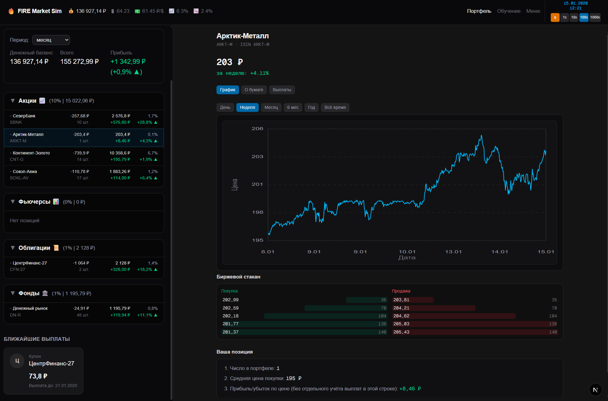

### История сделок
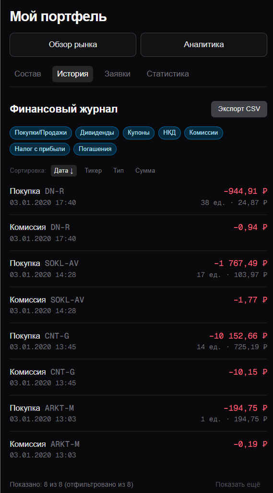

### Состав портфеля
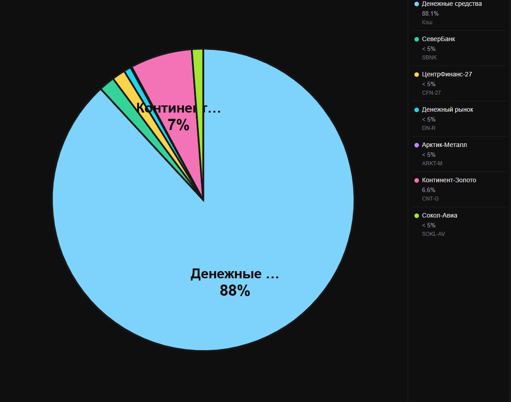

### Форма заявки на покупку
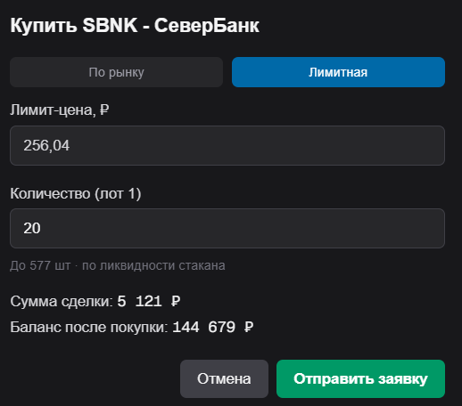

### Активные заявки
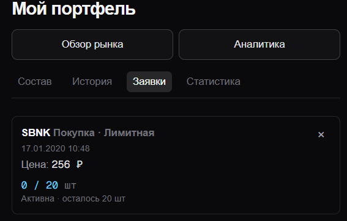

### Закрытый инструмент
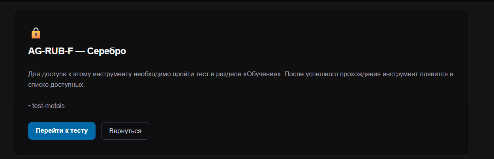

### Список лекций
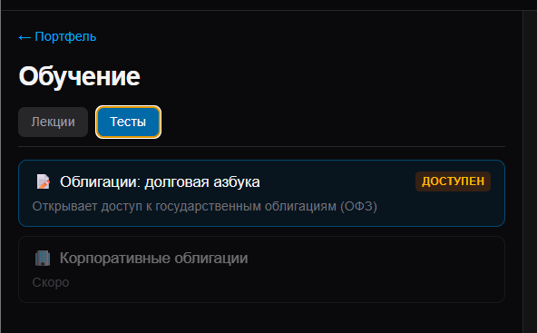

### Просмотр лекции
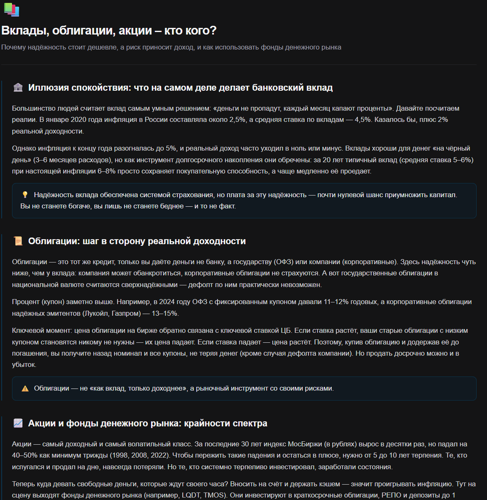

### Игровое меню
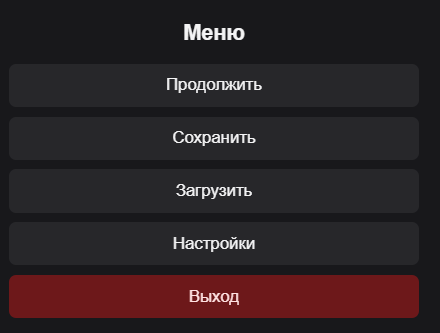

### Настройки
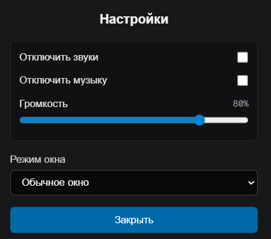

### Сохранение и загрузка
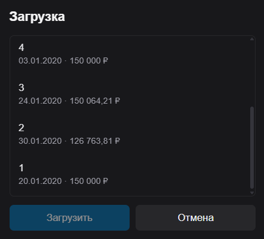